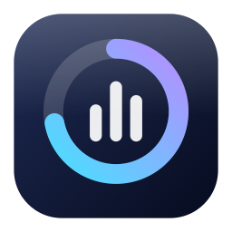
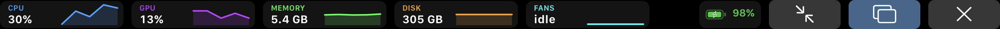

<div align="center">



# GlassDeck

**Your Mac's vitals, in Liquid Glass — on the menu bar and on the Touch Bar.**

[](https://github.com/FraCata00/glassdeck/actions/workflows/ci.yml)
[](https://github.com/FraCata00/glassdeck/releases/latest)
[](https://www.apple.com/macos/)
[](LICENSE)

**[fracata00.github.io/glassdeck](https://fracata00.github.io/glassdeck/)**

</div>

A menu bar system monitor for macOS: CPU, GPU, memory, disk, network, fans,
temperature, power and battery, read straight from the kernel and drawn in
Liquid Glass. On a MacBook Pro with a Touch Bar, it puts them there too.

No Dock icon, no network access, no root, no helper daemon.



## Install

```sh
brew tap fracata00/tap
brew trust fracata00/tap
brew install --cask glassdeck
```

Or download `GlassDeck.zip` from the [latest release](https://github.com/FraCata00/glassdeck/releases/latest),
move the app to `/Applications`, and right-click → **Open** the first time.
Releases are signed ad hoc rather than notarised (that needs a paid developer
account); the Homebrew cask clears the quarantine flag for you.

Requires macOS 15 or later, on Apple silicon or Intel. Liquid Glass needs macOS 26;
older systems get a vibrant-material fallback. Everything except the Touch Bar
works without one.

## What it shows

- **CPU** — total, user/system, per-core bars by performance and efficiency cluster, load average
- **GPU** — utilisation and video memory
- **Memory** — used and swap, counted the way Activity Monitor does, with the kernel's memory pressure
- **Disk** — read/write throughput and boot-volume capacity
- **Network** — up and down across every active interface
- **Fans, temperature, power** — from the SMC, read-only
- **Battery** — charge, state, time to full or empty
- **Bluetooth** — the charge of paired devices (off until you switch it on, since that is when macOS asks permission)
- **Clock** — extra time zones, one of them optionally in the menu bar
- **Top processes** — sampled only while a window is open

In English and Italian, following the system language.

## The Touch Bar

Four sizes, and shrinking never makes GlassDeck disappear: ⌄ steps down one
size at a time, ⤢ steps back up.

| Size | What you get |
| --- | --- |
| **Full width** | Every metric, fan RPM and battery |
| **Compact** | Four graphs and the battery, beside the system Control Strip |
| **Mini** | Just the meters |
| **One metric** | Tap any panel for its details and history |

The panels can be drawn in nine styles — Glass, Instrument, Capsule, Ambient,
Rings, Terminal, Histogram, Signal and Tinted glass — chosen in
*Settings → Touch Bar*, with a live preview of each.

The Control Strip item relies on private DFRFoundation and `NSTouchBar` entry
points, resolved at runtime; on a Mac without a Touch Bar they do nothing.

## Build from source

```sh
git clone https://github.com/FraCata00/glassdeck.git && cd glassdeck
swift build && swift test
Scripts/bundle.sh --debug && open .build/bundle/GlassDeck.app
```

Swift 6, SwiftPM only, no dependencies. The product page lives in
[`web/`](web/README.md). Commits follow [Conventional Commits](https://www.conventionalcommits.org/);
see [CONTRIBUTING.md](CONTRIBUTING.md).

## License

[MIT](LICENSE) © Francesco Cataldo. If GlassDeck has earned its place in your
menu bar, you can [sponsor the work](https://github.com/sponsors/FraCata00).
